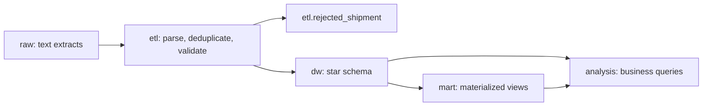
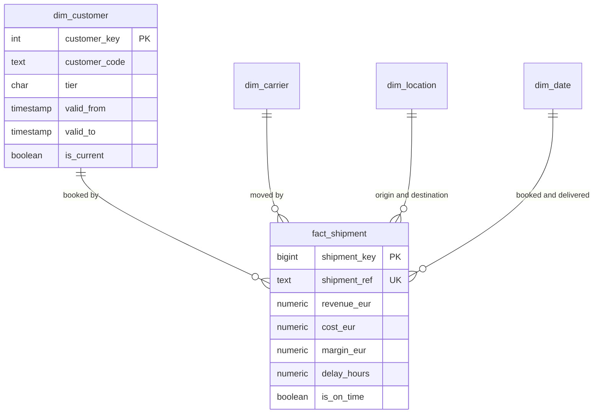

# Freight Analytics Warehouse


An end-to-end PostgreSQL data warehouse for a fictional freight forwarder. Messy operational extracts are cleaned, validated and modelled into a star schema, then used to answer pricing, carrier, customer and customs questions.

Everything is written in SQL and rebuilds from scratch with one command.

## At a glance

| Metric | Value |
| --- | --- |
| Raw shipment rows ingested | 47,388 |
| Bookings loaded into the fact table | 46,475 |
| Defective bookings quarantined with a reason | 217 |
| Delivered revenue analysed | EUR 37.0M |
| Automated data-quality tests | 15 |
| Business analyses | 7 |

All data is synthetic and generated deterministically, so every run produces identical results.

## Architecture





## Engineering highlights

- **Idempotent ETL.** Replaying the load inserts and updates zero rows, which the test suite verifies.
- **Slowly changing dimension (Type 2).** A set-based `MERGE` uses gaps-and-islands logic to collapse unchanged re-extracts. A deferred `EXCLUDE` constraint makes overlapping customer versions impossible.
- **Point-in-time accuracy.** Each shipment joins the customer version that was valid when it was booked.
- **Data-quality quarantine.** Bad records are kept with explicit reasons instead of being dropped silently.
- **Regional parsing.** Safe parsers handle `1.234,50` and `31.12.2024 18:30` and return `NULL` for garbage.
- **Multi-currency reporting.** Revenue and cost are converted to EUR at the booking month's exchange rate.
- **Performance.** Covering and partial indexes support the fact table, and materialized views with unique indexes serve the aggregates.

## Analyses

| File | Business question | SQL techniques |
| --- | --- | --- |
| `01_revenue_trend` | How are revenue and margin trending? | `LAG`, rolling frames, YTD, YoY |
| `02_lane_profitability` | Which lanes earn the profit and which need repricing? | Pareto share, `RANK`, `PERCENT_RANK` |
| `03_carrier_scorecard` | Which carriers deserve more volume? | `percentile_cont`, weighted composite score |
| `04_customer_cohort_retention` | Do new customers keep shipping? | Cohorts, pivoting, right-censoring |
| `05_rfm_churn_risk` | Which valuable customers are slipping away? | `NTILE`, inter-arrival gaps |
| `06_customs_bottlenecks` | Where does clearance break the delivery promise? | `GROUPING SETS`, percentiles |
| `07_margin_leakage` | How much margin is lost below target pricing? | `ROLLUP`, opportunity sizing |

Results from the latest run are in [`output/`](output).

## Sample findings

- Declarations lodged on Friday or Saturday take a median of 38 hours to clear, against about 8 hours on other days. Their on-time rate falls to roughly 53%, compared with 87 to 90%.
- Red-channel declarations reach an on-time rate of only 3.6%, against 91.8% for the green channel.
- 43.2% of delivered shipments are priced below their tier's target margin, a gap worth about EUR 1.0M.
- Carrier choice matters most at sea: SE01 delivers 91.7% on time with a 20-hour P95 delay, while SE02 delivers 75.1% with a 110-hour P95 delay.

## Run it

Requires PostgreSQL 15 or newer. CI runs on PostgreSQL 18.

```bash
export PGHOST=localhost PGUSER=postgres
./scripts/run_all.sh
```

The script creates a `freight_dw` database, replacing any existing database with that name.

## Project structure

```text
sql/        Schemas, seed data, warehouse model, ETL and marts
analysis/   Business analyses
tests/      Data-quality and reconciliation tests
output/     Results of each analysis as CSV
scripts/    One-command build
```
